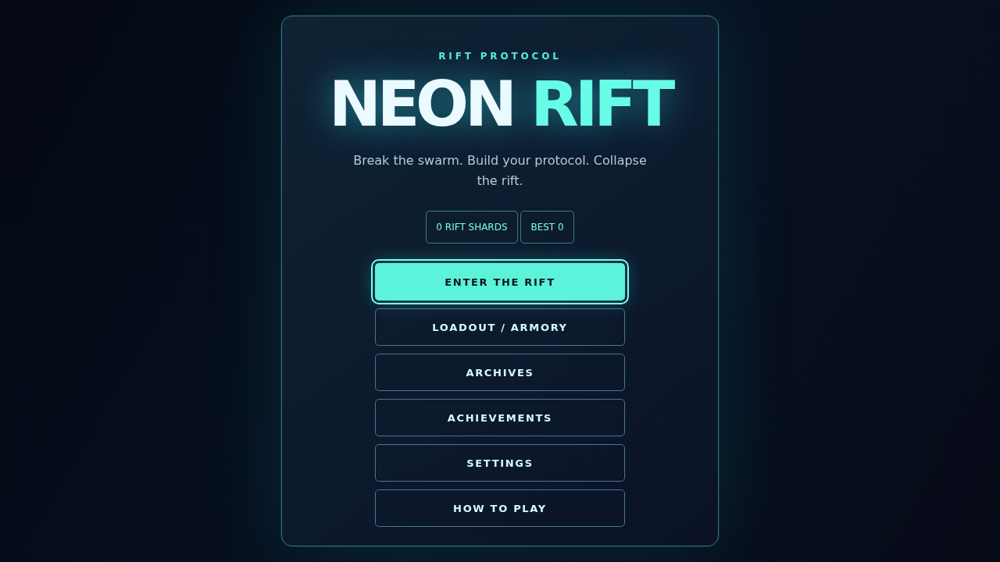
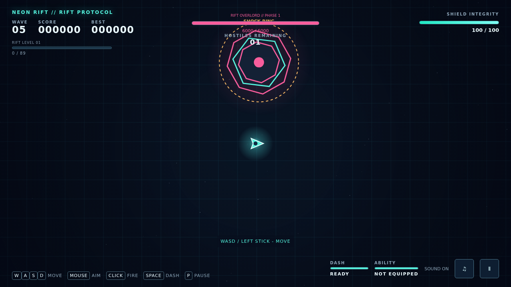
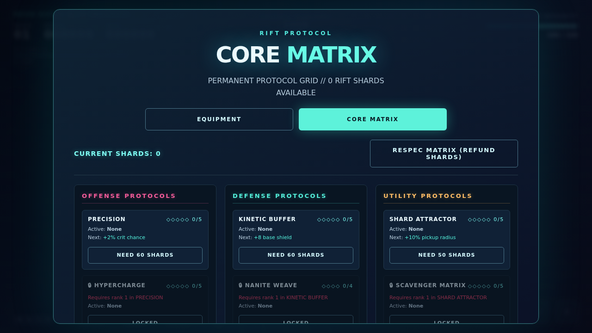
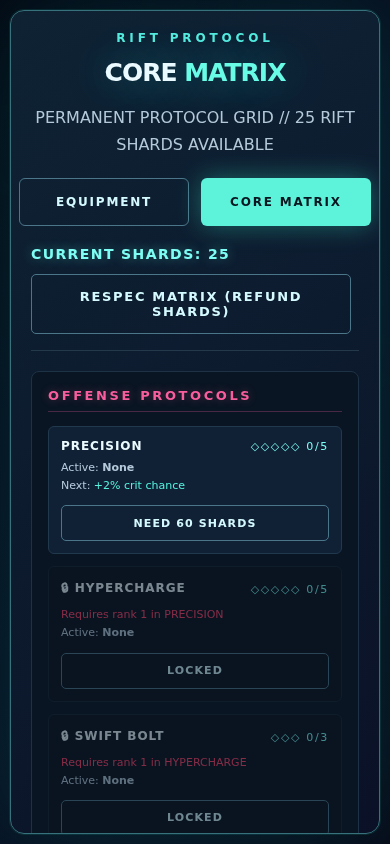
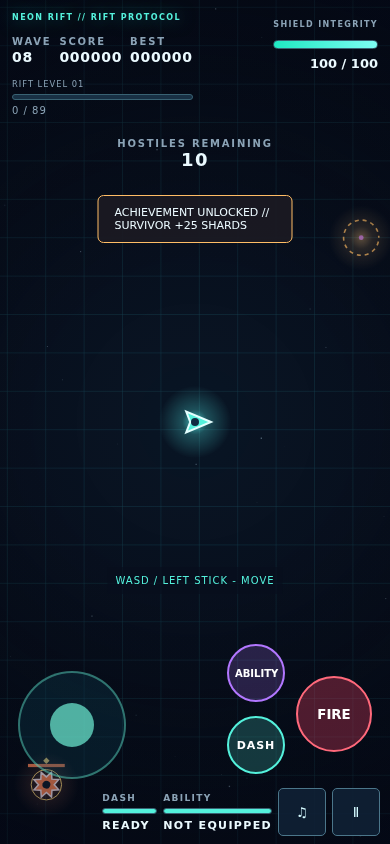

# NEON RIFT // RIFT PROTOCOL

A local-first neon roguelite survival shooter. The original cyan ship, movement, Phase Dash and wave-shooter identity are preserved; XP protocols, weapon/ship loadouts, telegraphed elites, Rift Overlord fights and permanent unlocks make each run a build.

**Release:** 2.0.1 (October 5, 2026). Separate V2 repository; no hosted deployment.

[Read the PDF guide](docs/NEON-RIFT-v2-Guide.pdf) | [Text guide](GUIDE.md) | [Current QA notes](docs/QA.md) No engine, framework, bundler, CDN, downloaded fonts or external game assets. Vanilla HTML/CSS/JavaScript, Canvas 2D, Web Audio and localStorage.

## Play
1. Extract the complete ZIP. Do not run inside the compressed archive.
2. Double-click the root `index.html`. Keep `css/` and `js/` alongside it.
3. Click **ENTER THE RIFT**. Audio starts after a user gesture.

A static host also works: `python3 -m http.server 8000`, then open `http://localhost:8000`. Python is optional and is not needed for double-click play. No package installation is needed to play.

Desktop browsers can open the folder directly. Phones normally need the folder on a static host; use landscape for more room. Portrait is supported. The game makes no external network requests.

## Controls
| Action | Desktop | Touch |
|---|---|---|
| Move | WASD / arrow keys | Left stick |
| Aim | Mouse | Drag right side |
| Fire | Hold left click | FIRE or right-side hold |
| Phase Dash | Space | DASH |
| Ability | E / Shift | ABILITY |
| Pause | P / Esc | Pause button |
| Pick protocol | 1/2/3, arrows + Enter, click | Tap card |
| Reroll | R / button | Button |

Rail Rifle is hold-to-charge, release-to-fire; a short tap produces a weak shot. Dash and ability never replace one another. Shockburst must first be unlocked/equipped, except on Adept.

## Features
- XP diamonds from every kill, accelerating attraction, queued level-ups and three-card protocol offers.
- 28 global upgrades, 15 weapon upgrades and 3 synergy protocols, plus 5 weapon evolutions; stacking, caps, rarity gates and two rerolls per run (more with Protocol Analyst).
- Five weapons: Pulse Cannon, Nova Shotgun, Rail Rifle, Arc Blaster, Void Orb.
- Four ships: Striker, Wraith, Titan, Adept; innate Phase Dash plus unlockable Shockburst.
- Threat-budget waves, onboarding, hostiles counter, six-tenths-second spawn warnings and alive caps.
- Chaser, Dasher, Tank, Phantom, Bomber, Rift Mage and Sentinel; Swift/Armored/Volatile affixes.
- Six pickups, combo scoring, flawless wave bonuses, floating text and timed buff chips.
- Rift Overlord every fifth wave: phase transitions, Bullet Ring, Laser Sweep, Rift Summon, Charge and Shock Ring.
- Boss rewards, Rare-or-better free protocol, first-kill Nova unlock, run summary, shards and local armory.
- 12 achievements and discovery-based archives; four arena themes, five events, three hazards.
- Procedural audio/music, low-shield heartbeat/filter, volume buses, pause duck/filter, quality tiers, reduced motion and mobile controls.
- Core Matrix: 12 permanent talent nodes across offense, defense and utility, with shard purchase and full-refund respec.
- Five weapon evolutions unlocked by weapon-upgrade level 5 plus a catalyst protocol. Each run starts unevolved.
- Shootable Rift Nodes, drifting gravity pockets, touch aim assistance (off/low/strong), and checksum-checked save backup/restore.

## Weapons and unlocks
| Weapon | Damage | Cooldown | Unlock |
|---|---|---|---|
| Pulse | 10 | 0.115 s | Start |
| Nova | 7 x 8 pellets | 0.75 s | First boss kill |
| Rail | 120 full charge | 0.9 s | 400 shards |
| Arc | 14 plus chains | 0.16 s | 300 shards |
| Void | 44 direct + 15 splash | 0.6 s | 500 shards |

Arc and Void direct damage were tuned upward from the starting brief (9 and 20) to bring single-target damage closer to Pulse. Nova rewards close positioning. See `docs/QA.md` for measured boss benchmarks and unverified balance claims.

Wraith costs 200 shards, Titan 350, Adept 450. Shockburst costs 250. Crimson Sector costs 150, Dead Circuit 250, Void Core 400.

## Progression / saves
Save key: `neon-rift-save-v2`, version 2. V1 `neon-rift-best` is imported if the new save is missing. Corrupt JSON is copied to `neon-rift-save-v2-corrupt`; defaults and a notice are used. Unknown loadouts are checked against actual tables. Blocked/full storage falls back to memory for the current page session. Progress is local to the browser/origin/file location, not a cloud account.

Run-end shards: floor(wave x 4 + kills / 8 + level x 2). Boss shards are awarded immediately: 50 on the first-ever kill, 40 afterward. Achievements reward 25-100 once. Settings includes confirmed RESET PROGRESS.

## New systems / corrected behavior
- **Elite Radar:** each rank raises the base elite-affix chance by 15% relatively, and adds one shard per elite kill. Rank 3 changes a capped base 15% chance to 21.75%; existing alive-elite caps still apply. It does not multiply all enemy-type spawning.
- **Singularity Lance:** its beam draws enemies toward the line without overshooting it.
- **Talent safety:** known IDs only, integer ranks capped to each node's maximum, and each tier requires at least rank 1 in the prior tier. All imports and legacy talent-key migration share the same validator. Invalid ranks are removed/clamped, not refunded as purchases.
- **Save ownership:** the main V2 save is authoritative; the old `neon_rift_talents` key is used only when no main save/talents field exists. Respec and restore cannot resurrect stale legacy ranks.
- **Backup:** Settings > Export Save copies/downloads `NRSAVE1` text. Import Save validates checksum/schema and replaces stored progression. Back up first. The checksum detects corruption, not tampering or account identity.

## Architecture / load order
```
neon-rift/
  index.html
  css/ main.css hud.css menus.css responsive.css
  js/
    config.js utils.js save.js audio.js input.js particles.js
    stats.js upgrades.js weapons.js abilities.js enemies.js bosses.js
    waves.js pickups.js achievements.js player.js render.js ui.js
    game.js debug.js main.js
  legacy-v1/index.html
  tests/ (optional development QA; not needed to play)
  docs/ (screenshots, QA and build notes; not loaded by game)
  README.md CHANGELOG.md
```
Classic deferred scripts, one `NR` namespace and event bus. `game.js` owns states; gameplay uses world-scaled values. `stats.js` combines additive and multiplicative modifiers with caps. DOM menus/HUD are separate from Canvas world drawing. Pools cap bullets, gems, particles and texts. Spatial hashing narrows projectile collision candidates; cached glows avoid entity shadowBlur.

Data tables: `NR.WEAPONS`, `NR.ENEMY_TYPES`, `NR.UPGRADES`, `NR.ABILITIES`, `NR.BOSSES`, `NR.SHIPS`, `NR.ARENAS`, `NR.ACHIEVEMENTS`, `NR.PICKUPS`. Most tuning is in `config.js` or these tables. Some effect/timing constants remain inline; centralizing all of them is a documented follow-up rather than a claim of exact numeric compliance.

## Add content
- **Enemy:** add an `ENEMY_TYPES` entry with name, shape, color, radius, HP/speed functions, contact, XP/score, threat cost and first wave. Add behavior in `enemies.js` if the pattern is new.
- **Weapon:** add a `WEAPONS` entry with damage/cooldown/projectile data, pattern, tags, sound and unlock. Existing patterns can reuse the manager; new patterns need fire/collision code.
- **Upgrade:** add a definition in `upgrades.js`, with category, rarity, maximum level, tags and stat modifier/effect. Offer rules exclude maxed/incompatible entries.
- **Boss:** add a `BOSSES` entry. Existing attack IDs reuse the scheduler; a new attack needs update and renderer support. The schedule currently selects Overlord, so select a new ID in the wave/intro route when adding a second boss.

## Debug / tests
Append `?debug=1` to enable `window.__neonRift` and `NR.test.run()`. Debug mutators: skipToWave, spawn, spawnBoss, giveXP, levelUp, giveUpgrade, setWeapon, forceEvent, god, timeScale, perfOverlay, corruptSave, seed. `window.__neonRiftDebug()` is a read-only snapshot on both URLs. Debug controls are not drawn in normal play.

Development tests use Python Playwright: install Playwright and Chromium separately, then run `python3 tests/core_playwright.py`, `effects_playwright.py`, `targeted_playwright.py` or `playthrough_playwright.py` or `regression_playwright.py`. They are not game dependencies. Tests deliberately manipulate state to verify effects; use a disposable browser profile. Saved JSON results describe the actual build checks. The playthrough script also attempts Firefox/WebKit; a missing browser is reported as unverified.

For an installed system Chrome instead of Playwright's bundled Chromium:
`NEON_CHROME=/path/to/google-chrome python3 tests/regression_playwright.py`

## Verification and limits
Current Chrome checks: 33/33 core, 25/25 effects/input, 25/25 new regressions, plus targeted hazards/caps/pause and controller-driven wave 11. Five evolved weapons passed eligibility/install/damage smoke checks. All scripts pass syntax checking. The accelerated soak reached wave 53 with no non-finite positions; this is not a 30-minute wall-clock memory/audio test.

Safari/WebKit, Edge, Firefox in this review environment and real phones remain unverified. Synthetic mobile layouts/controls are not a physical-device performance guarantee. See `docs/QA.md` for methods, exact limits and results. The archived Oct 4 QA/guide are historical and do not describe every current system.

## Screenshots

### Menu


### Boss fight


### Permanent upgrades


### Mobile layout



Older illustrative captures and the historical guide are preserved in docs/ and labeled accordingly.

## Known issues / roadmap
- Full four-browser/device matrix and a real-time audio/memory soak remain to be done.
- The ±15% sustained weapon DPS goal is not claimed as verified; recorded idealized boss times are a tuning aid, not equivalent to player DPS.
- Some visual details are simpler than the brief: no camera zoom, compact summary count-up, and shared music/SFX recipes for some cues.
- UI focus and touch ownership were tested, but real assistive-technology and real-phone ergonomics need user testing.
- Future: a second boss, more weapons, daily challenge, gamepad support, additional abilities and Laser Grid. Touch aim assistance, permanent nodes and export/import ARE implemented; full autonomous auto-aim is not.
